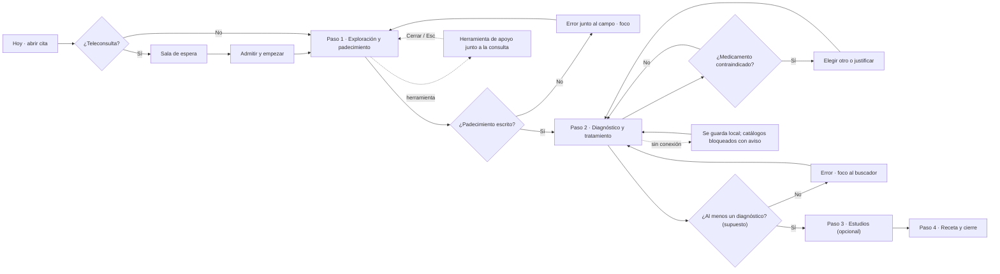

# User flow · registrar una consulta

**Entrada:** «Hoy» → cita del paciente (presencial o teleconsulta) · **Endpoint observable:** consulta con padecimiento, diagnóstico(s) y tratamiento; paso 4 «Receta y cierre» habilitado.

| Paso | Intención | Error posible | Recuperación | ¿Se puede volver? |
|---|---|---|---|---|
| Sala de espera | Admitir al paciente | Sin cámara/permiso | Mensaje + cómo dar permiso; seguir sin video | Sí |
| Paso 1 | Registrar signos y padecimiento | Padecimiento vacío; valor fuera de rango | Error con sugerencia; aviso con rango normal | Sí |
| Paso 2 | Diagnosticar y tratar | Sin diagnósticos; contraindicación; pauta incompleta | Error + foco; justificar o elegir otro; error junto al campo | Sí, quitar con deshacer |
| Herramienta | Consultar sin salir | Error al cargar | «Reintentar»; la consulta sigue | Cerrar / Esc |
