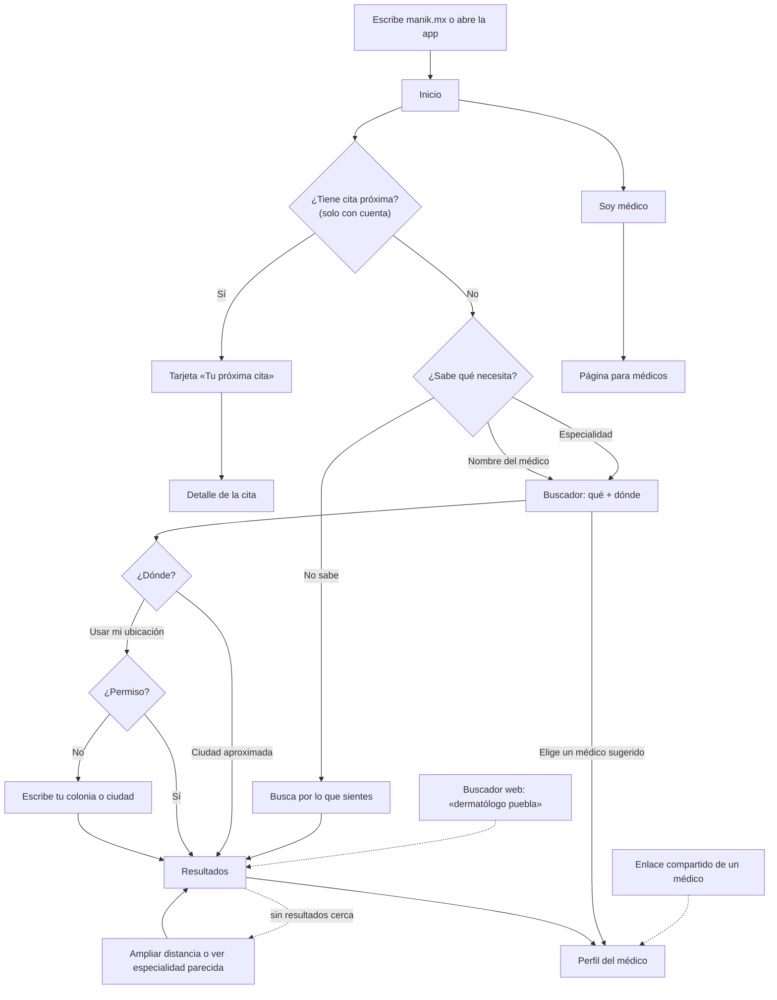

# User flow · Encontrar médico desde el inicio

**Entrada:** escribe la dirección, abre la app o vuelve a Manik (las entradas por buscador o enlace compartido van directo a resultados o perfil). · **Endpoint observable:** resultados de una especialidad cerca, perfil del médico buscado o detalle de la próxima cita.

| Paso | Intención | Error posible | Recuperación | ¿Se puede volver? |
|---|---|---|---|---|
| Inicio | Entender qué es Manik y empezar | Sin conexión | Aviso; lo estático funciona | — |
| Buscador | Decir qué y dónde | No sabe cómo se llama la especialidad | Sugerencias por síntoma y por nombre; «Busca por lo que sientes» | Sí (conserva lo escrito) |
| Dónde | Ubicar la búsqueda | Permiso denegado | Campo de colonia o ciudad; nunca bloquea | Sí |
| Lo que sientes | Orientarse sin saber de especialidades | No encuentra su síntoma | «Chequeo general» siempre presente | Sí |
| Resultados | Comparar | Nada cerca | Ampliar distancia o especialidad parecida | Sí (conserva filtros) |
| Próxima cita | Revisar o cambiar su cita | Cita cancelada por el consultorio | Aviso en la tarjeta + reagendar | Sí |
