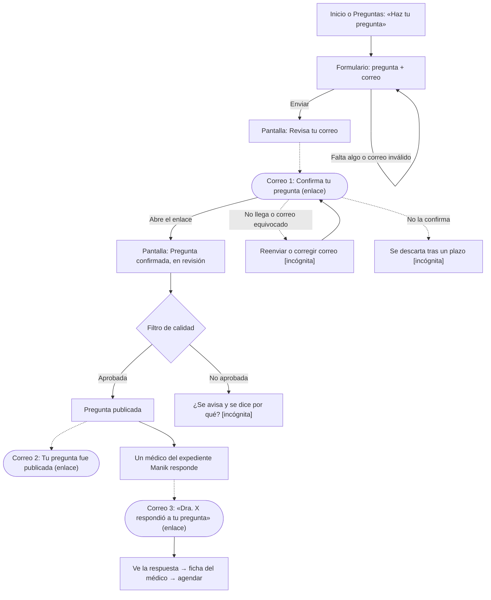

# Flujo F0 · Hacer una pregunta (sin cuenta) · r01

Fuente: descripción del usuario (2026-11-04). Lo marcado [incógnita] no lo definió el usuario.

## Estados de la pregunta
| Estado | Lo ve el público | Qué lo dispara | Correo |
|---|---|---|---|
| Pendiente de confirmar | No | Enviar el formulario | Correo 1 |
| En revisión | No | Abrir el enlace de confirmación | — |
| Publicada (sin respuesta) | Sí | Pasa el filtro | Correo 2 |
| Respondida | Sí | Responde un médico | Correo 3 (uno por médico [supuesto]) |
| No aprobada | No | No pasa el filtro | [incógnita] |
| Vencida | No | No se confirma a tiempo | [incógnita] |
