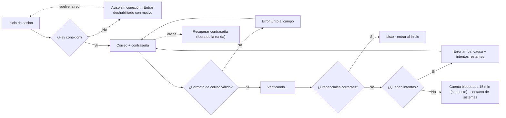

# User flow · entrar a Nabi

**Entrada:** abrir Nabi o cerrar sesión · **Endpoint observable:** «Listo» en el botón y transición al inicio de Nabi.

| Paso | Intención | Error posible | Recuperación | ¿Se puede volver? |
|---|---|---|---|---|
| Formulario | Escribir credenciales | Formato de correo | Mensaje junto al campo | Sí |
| Verificando | Esperar | Red lenta | La carga sigue; lo escrito se conserva | Sí |
| Error | Corregir | Contraseña incorrecta | Mensaje con intentos restantes | Sí |
| Bloqueo | Saber qué hacer | — | Tiempo de espera + contacto | Tras el tiempo |
